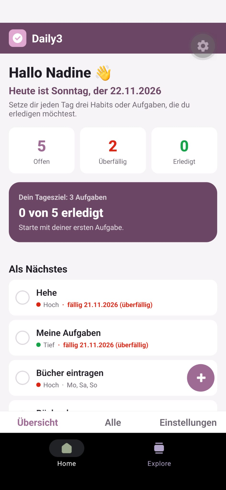
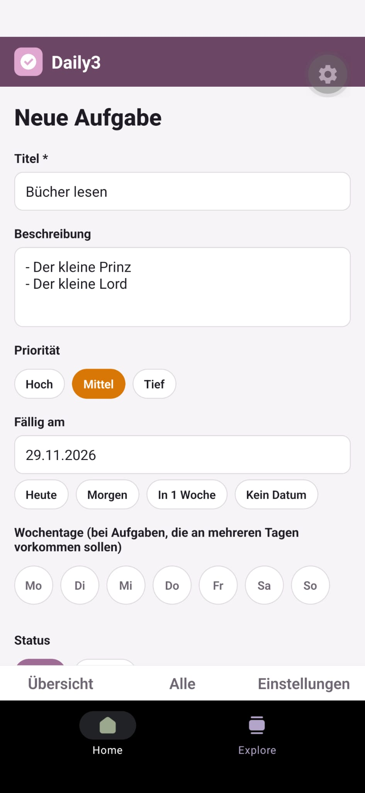
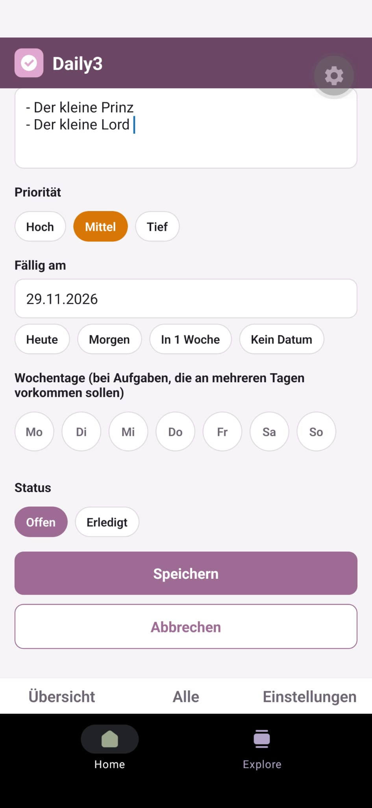
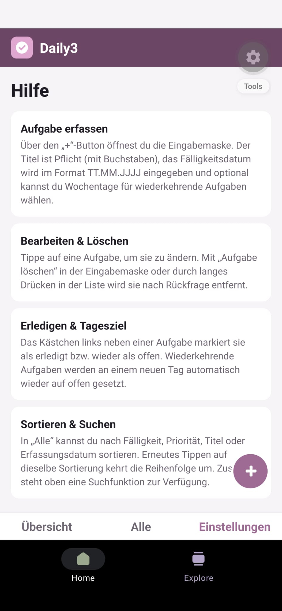
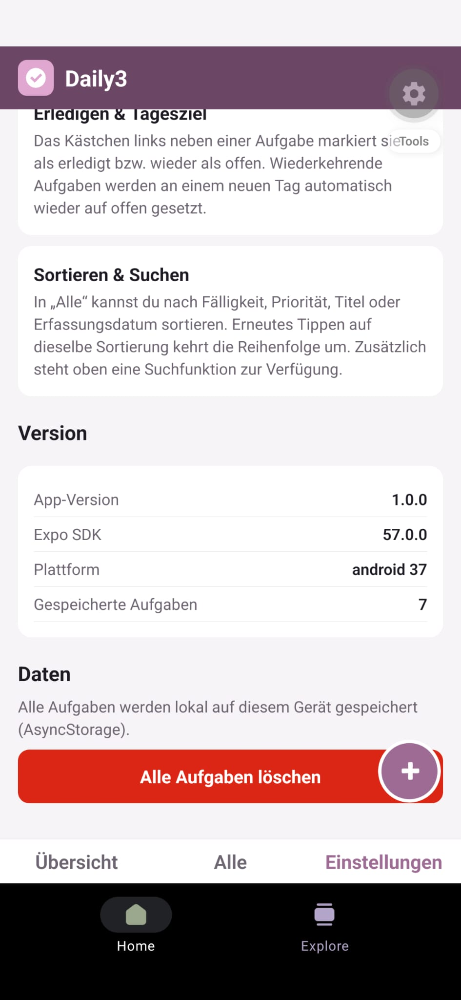
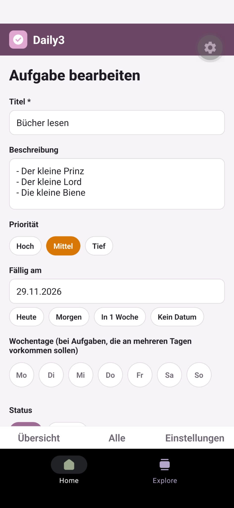
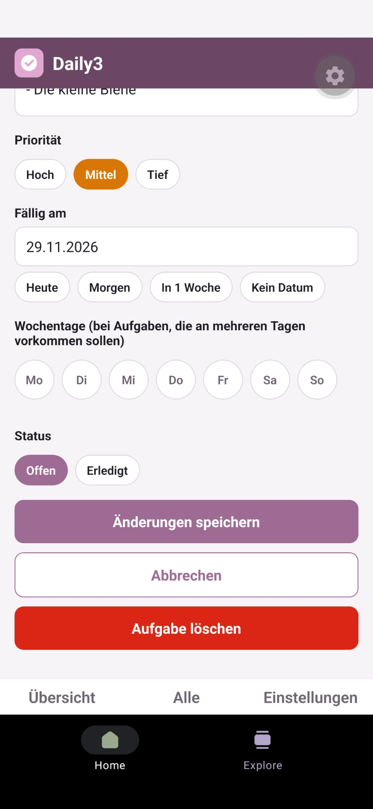
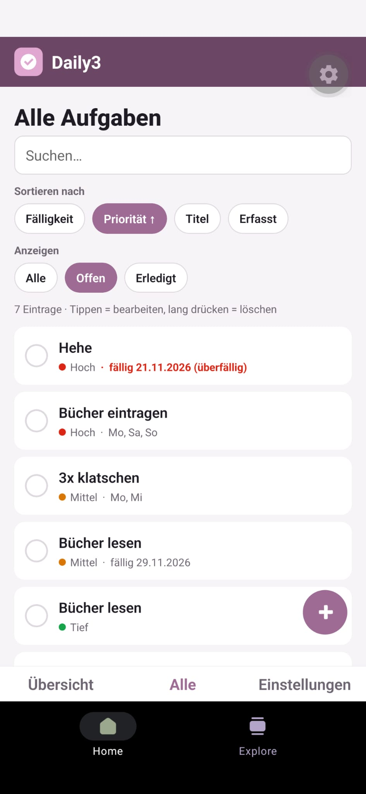

# Daily3 – Mobile App Development

## 1. Projektübersicht

### Projektidee
**Daily3** ist eine mobile Aufgaben- und Habit-Tracking-App, die Nutzerinnen und Nutzer dabei unterstützt, täglich kleine Gewohnheiten und Aufgaben zu verfolgen. Der Fokus liegt auf Einfachheit und Motivation: Anstatt viele Pendenzen gleichzeitig zu verwalten, setzt sich die App das Tagesziel von **drei** erledigten Aufgaben oder Gewohnheiten. Natürlich können auch mehr als drei Aufgaben abgehakt werden – das Ziel von drei pro Tag dient als motivierender Rahmen ohne Überforderung.

### Zielgruppe
* Personen, die neue tägliche Gewohnheiten aufbauen möchten
* Studierende, die eine einfache App zur Strukturierung ihrer Aufgaben benötigen
* Berufstätige mit wenig Zeit
* Nutzerinnen und Nutzer, die eine schlanke Alternative zu komplexen To-Do-Apps bevorzugen

### Zielsetzung
Die App soll:
* den täglichen Fortschritt sichtbar und nachvollziehbar machen
* mit Bildern und GIFs (z. B. nach erledigten Tagesaufgaben) motivierend wirken
* eine simple, intuitive und schnell bedienbare Oberfläche bieten

---

## 2. Design und Planungsvorgehen

Der erste Entwurf wurde auf Figma erstellt:  
[Figma-Board: Daily 3](https://www.figma.com/design/W0UqR55pHUycfnpZvTXywA/Daily-3?t=DDw96ykMDkmSIrOb-1)

Das Figma-Board diente als Grundlage für die Planung der Benutzeroberfläche und der Kernfunktionen. Während der Umsetzung wurden bewusst Anpassungen vorgenommen, um die App übersichtlicher zu gestalten und den Fokus auf die wichtigsten Funktionen zu legen:

* Entfernung des Fortschrittskreises auf der Startseite
* Entfernung zusätzlicher Icons innerhalb einzelner Aufgabenzeilen
* Vereinfachung der Statistikansicht
* Fokus auf eine klarere Benutzerführung und ein einheitliches Farbschema

Eine visuelle Übersicht ist unter `Daily 3.png` hinterlegt.

---

## 3. Technische Umsetzung

### Verwendete Technologien
* **React Native** – Entwicklung der mobilen Benutzeroberfläche
* **Expo** – Entwicklungsumgebung und Ausführung über Expo Go
* **TypeScript** – Typisierung und höhere Code-Sicherheit
* **React Navigation / Screen-Steuerung** – Wechsel zwischen den Ansichten (`Übersicht`, `Alle`, `Einstellungen`/`Hilfe`, Bearbeiten)
* **`AsyncStorage`** – Lokale Persistenz der Aufgaben und des täglichen Reset-Datums auf dem Gerät

### Verwendete Befehle & Setup
> **Hinweis zum Starten:** Beim Öffnen des Terminals befindet man sich häufig im übergeordneten Ordner `Mobile_app_development`. Zuerst muss in den Projektordner `daily3` gewechselt werden.

```bash
cd daily3
npm install
npx expo install @react-native-async-storage/async-storage expo-constants react-native-safe-area-context
npx expo start
```

### Projektstruktur
```text
daily3/
├── src/
│   ├── app/
│   │   └── index.tsx
│   ├── bilder/
│   ├── components/
│   │   ├── Button.tsx
│   │   ├── Chip.tsx
│   │   ├── DailyGoalCard.tsx
│   │   └── TaskRow.tsx
│   ├── constants/
│   │   └── tasks.ts
│   ├── hooks/
│   │   └── useTasks.ts
│   ├── screens/
│   │   ├── EditScreen.tsx
│   │   ├── HelpScreen.tsx
│   │   ├── HomeScreen.tsx
│   │   └── ListScreen.tsx
│   ├── styles/
│   │   └── appStyles.ts
│   ├── types/
│   │   └── task.ts
│   └── utils/
│       └── taskHelpers.ts
└── package.json
```

---

## 4. Hauptfunktionen

### Startseite (`Übersicht`)
Auf der Startseite erhält die Nutzerin bzw. der Nutzer einen direkten Überblick über das aktuelle Datum, die Tagesstatistik (`Offen`, `Überfällig`, `Erledigt`), die `DailyGoalCard` mit dem Tagesziel von drei Aufgaben sowie die anstehenden Aufgaben unter **„Als Nächstes“**. Aufgaben lassen sich direkt abhaken, wodurch sich die Statistik sofort aktualisiert.

### Aufgabe / Gewohnheit hinzufügen & bearbeiten
Über den `+`-Button (oder durch Antippen einer bestehenden Aufgabe) öffnet sich die Bearbeitungsansicht. Dort lassen sich Titel (Pflichtfeld mit Buchstaben-Validierung), Beschreibung, Priorität, Fälligkeitsdatum (inkl. Schnellauswahl wie *Heute*, *Morgen*, *In 1 Woche*), wiederholende Wochentage (`Mo`–`So`) sowie der Status festlegen. Gespeicherte Aufgaben werden lokal über `AsyncStorage` persistiert.

### Gesamtübersicht (`Alle`)
Zeigt alle erfassten Aufgaben an und bietet eine Suchfunktion, Sortieroptionen (z. B. nach Fälligkeit, Priorität, Titel, Erfassungsdatum – jeweils auf- oder absteigend) sowie Filter nach Status. Durch Tippen wird eine Aufgabe bearbeitet, durch langes Drücken nach Rückfrage gelöscht.

### Einstellungen & Hilfe
Bietet eine Übersicht über die Bedienung der App, technische Versionsinformationen (App-Version, Expo SDK, Plattform, Anzahl gespeicherter Aufgaben) sowie die Möglichkeit, alle Aufgaben nach Bestätigung zurückzusetzen.

---

## 5. Herausforderungen & Lösungen

* **Wiederkehrende Aufgaben & Tageswechsel:** Im Verlauf der Entwicklung erneuerten sich erledigte Aufgaben am nächsten Tag nicht automatisch wieder als offen. Gelöst wurde das durch eine tägliche Datumsprüfung (`daily3_last_reset_date`) in Kombination mit `repeatDays` und `isTaskForToday`.
* **Speicherschlüssel (`STORAGE_KEY`) beim Refactoring:** Durch das Auslagern in Konstanten fiel beim Umbenennen des Storage-Keys auf, dass bestehende Daten unter dem alten Schlüssel lagen. Ein einheitlicher, zentraler `STORAGE_KEY` verhindert künftig Konflikte.
* **Eingabevalidierung für Aufgabentitel:** Reine Zahlen- oder Sonderzeichenketten sowie Zeichensalate ohne sinnvollen Buchstabenanteil werden in der Formularvalidierung abgefangen und mit einer klaren Fehlermeldung zurückgewiesen.
* **Probleme mit Bild-Verlinkungen:** Relative Pfade sowie Leerzeichen in Ordnernamen führten bei der Einbindung von Bildern/Screenshots zunächst zu Darstellungsproblemen. Durch saubere relative Pfade (`daily3/bilder_readme/...`) und eindeutige Dateinamen lassen sich alle Bilder zuverlässig einbinden.
* **Aufräumen von totem Code & alten Props:** Nach dem Refactoring und der Navigation über Tab-Bar und `+`-Button waren einzelne Props und Styles überflüssig und führten nach Anpassungen an den Screens zu TypeScript-Meldungen – durch konsequentes Entfernen ungenutzter Teile läuft alles sauber und ohne Warnungen.

---

## 6. Annahmen & Grenzen

* Die Datenhaltung erfolgt rein lokal auf dem Gerät über `AsyncStorage`; es gibt aktuell keine Cloud-Synchronisation oder Benutzerkonten.
* Das Tagesdatum und der tägliche Reset orientieren sich an der lokalen Gerätezeit.
* Es werden aktuell keine Push-Benachrichtigungen oder Erinnerungen versendet.

---

## 7. Screenshots

* 
* 
* 
* 
* 
* 
* 
* 

<!-- Die verwendeten Bilder und GIFs liegen im Ordner src/bilder -->

---
